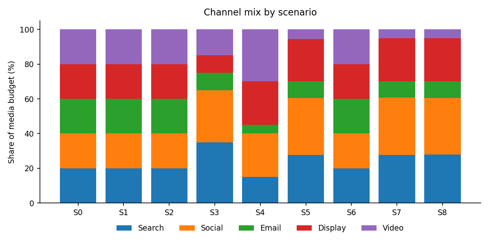
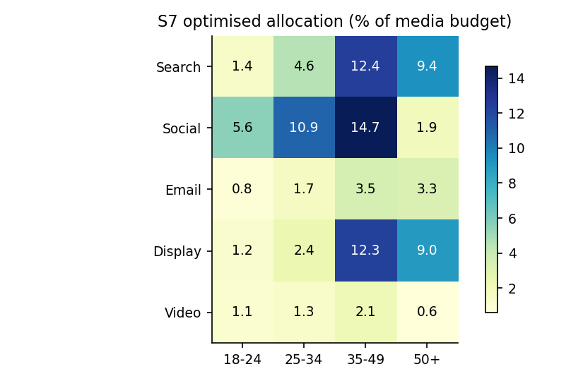
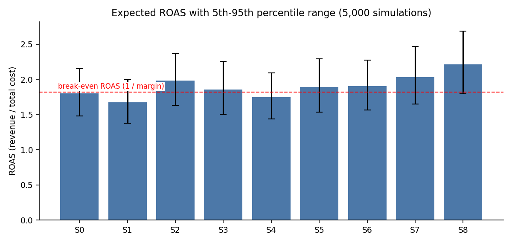
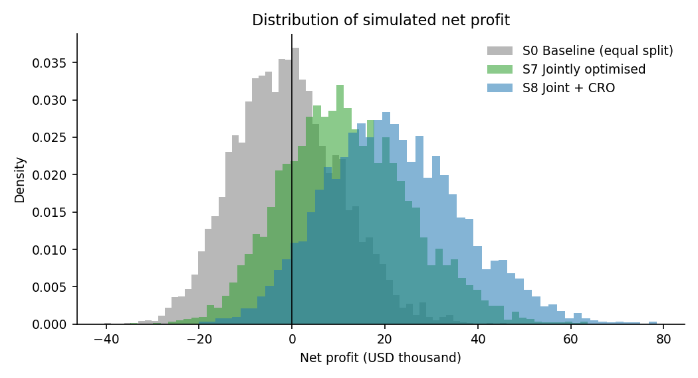
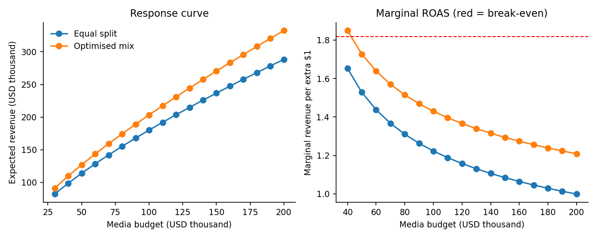
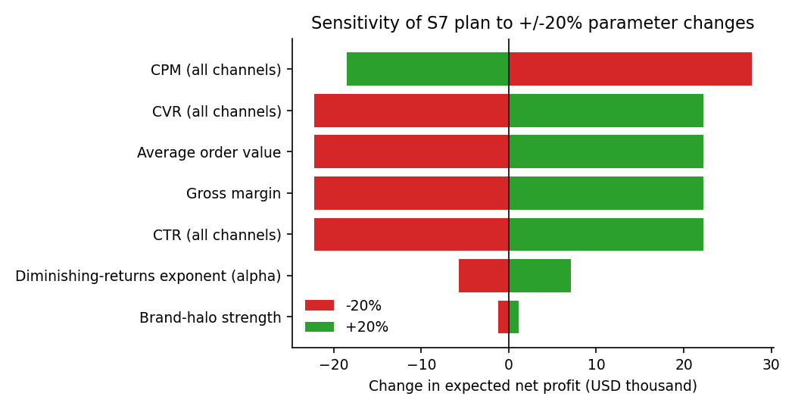

# Campaign Optimization Simulation Report

**Week 4 Task - Simulation of Campaign Optimization Strategies**  
Author: Gunjan  
Date: October 2026


## 1. Executive summary

This study builds a Monte Carlo simulation of a $100,000, 90-day e-commerce campaign spread over five channels (Search, Social, Email, Display, Video) and four customer segments (18-24, 25-34, 35-49, 50+). It tests how budget level, channel mix, segment targeting and conversion-rate optimisation (CRO) change revenue, profit and ROAS, using 5,000 simulated market outcomes per scenario and a constrained optimiser to find allocations.

- **Baseline (equal split)** is roughly break-even: expected net profit -$973, ROAS 1.80, and a 55% chance of losing money.
- **Joint channel x segment optimisation (S7)** lifts expected net profit to $11,842 (+$12,815 vs baseline, 95% CI +$12,698 to +$12,932) and cuts the probability of loss to 20%.
- **Adding a CRO programme (S8)** (+12% conversion rate for $4,000) is the best scenario: net profit $21,766, ROAS 2.21, probability of loss 6%. CRO adds $9,924 on top of S7 for a $4,000 outlay.
- **Spending more is not the answer.** Under diminishing returns, the last dollar at a $100,000 budget returns only about $1.43 of revenue, below the break-even level of $1.82 (1 / gross margin). A +25% budget (S1) *reduces* expected profit by $8,967.
- **Segment targeting matters most among single levers**: S6 (+$5,675) slightly beats channel optimisation S5 (+$4,934); doing both gives +$12,815.
- The optimised plan keeps beating the baseline in all 6 stress tests where benchmark assumptions are wrong (Section 9), so the recommendation is robust to parameter error, though absolute profit is not.


## 2. Objective and hypotheses

**Objective.** Use a data-driven simulation to quantify how changes in budget allocation, channel mix and target segmentation would affect campaign performance (revenue, conversions, CPA, ROAS, ROI, net profit), and to convert the results into practical recommendations.

**Hypotheses** (each is evaluated in Section 8):

| # | Hypothesis |
|---|---|
| H1 | Shifting budget from low-efficiency to high-efficiency channels raises ROAS and profit at the same total budget. |
| H2 | Concentrating spend on high-intent, high-basket segments (25-49) raises profit more than it raises cost. |
| H3 | Optimising channel mix and segments jointly beats either lever on its own (positive interaction). |
| H4 | Returns to budget are diminishing: marginal ROAS is below average ROAS, so extra budget has falling efficiency. |
| H5 | Upper-funnel awareness spend (Display/Video) has value through a halo on Search, but only up to a point. |


## 3. Data, benchmarks and assumptions

The model uses conservative, illustrative assumptions anchored to current public benchmark sources rather than claiming that the benchmark averages are the campaign's own performance. For example, WordStream's 2026 Google Ads benchmark reports overall CTR 6.64%, CPC $5.42 and CVR 8.18%; its 2025 Facebook lead benchmark reports CTR 2.59% and CVR 7.72%; and Mailchimp reports an all-user email click rate of 2.62%. The simulation deliberately uses lower, scenario-specific starting rates where appropriate to avoid treating broad US benchmark averages as ground truth for an unspecified e-commerce campaign. Source URLs and the mapping rationale are recorded in the Excel `Benchmark_Sources` sheet. The raw inputs are stored in `data/*.csv` so they can be audited and changed.

**Benchmark source register**

| Source | Current anchor | Role in this model | URL |
|---|---|---|---|
| WordStream 2026 Google Ads | CTR 6.64%; CPC $5.42; CVR 8.18% | Search external anchor; model uses a conservative starting point | https://www.wordstream.com/blog/2026-google-ads-benchmarks |
| WordStream 2025 Facebook leads | CTR 2.59%; CVR 7.72% | Social external anchor; model uses a conservative starting point | https://www.wordstream.com/blog/facebook-ads-benchmarks-2025 |
| Mailchimp email benchmarks | All-user click 2.62%; ecommerce click 1.74% | Email click-rate anchor; purchase CVR remains illustrative | https://mailchimp.com/resources/email-marketing-benchmarks/ |

The external figures are not treated as interchangeable metrics: search/social benchmark CVR definitions can differ from an e-commerce purchase conversion, and email click rate is not the same as purchase CVR. That distinction is why the model labels its channel inputs as illustrative assumptions rather than direct benchmark copies.

**Business assumptions**

| Assumption | Value | Comment |
|---|---|---|
| Total budget | $100,000 | 90-day campaign, fixed for scenarios S0, S3-S8 |
| Average order value | $130 | Scaled by segment (0.75-1.20) |
| Gross margin | 55% | Break-even ROAS = 1.82 |
| Brand halo on Search | up to +20% conversions | Saturates when Display+Video >= 30% of budget |
| Uncertainty (log-normal sigma) | CPM 10%, CTR 12%, CVR 15%, market 5% | Mean-one shocks |
| Simulations / seed | 5,000 / 42 | Common random numbers across scenarios |

**Channel benchmarks** (implied CPC and CPA are derived: CPC = CPM / (1000 x CTR); CPA = CPC / CVR)

| Channel | CPM | CTR | CVR | Implied CPC | Implied CPA | Alpha |
|---|---|---|---|---|---|---|
| Search | $86.0 | 3.20% | 3.75% | $2.69 | $72 | 0.65 |
| Social | $12.0 | 0.90% | 2.00% | $1.33 | $67 | 0.80 |
| Email | $30.0 | 2.30% | 2.00% | $1.30 | $65 | 0.40 |
| Display | $3.5 | 0.46% | 0.80% | $0.76 | $95 | 0.85 |
| Video | $9.0 | 0.65% | 1.20% | $1.38 | $115 | 0.80 |

`Alpha` is the diminishing-returns exponent (1 = linear; lower = faster saturation). Email is lowest because a customer list is finite; Search is limited by query volume.

**Segment multipliers**

| Segment | CPM x | CVR x | AOV x | Rationale |
|---|---|---|---|---|
| 18-24 | 0.90 | 0.70 | 0.75 | Cheaper to reach, lower purchase intent and basket size |
| 25-34 | 1.15 | 1.10 | 1.00 | Highly contested audience, strong intent |
| 35-49 | 1.10 | 1.25 | 1.20 | High intent and highest basket size |
| 50+ | 0.85 | 1.00 | 1.10 | Cheaper to reach, steady intent, lower engagement with social/video |

A channel x segment CTR affinity matrix (`data/channel_segment_affinity.csv`) captures, for example, that Social/Video over-index with younger users and under-index with 50+.


## 4. Simulation methodology

For each channel c and segment s with spend x(c,s):

```
impressions = imp_ref * (x / x_ref) ^ alpha_c          imp_ref = x_ref / (CPM_c * cpm_mult_s) * 1000
clicks      = impressions * CTR_c * affinity(c,s)
conversions = clicks * CVR_c * cvr_mult_s * (1 + halo if c = Search)
revenue     = conversions * AOV * aov_mult_s
net profit  = margin * revenue - (media spend + fixed cost)
ROAS = revenue / cost     CPA = cost / conversions     ROI = net profit / cost
```

`x_ref` is the equal-split spend per cell at the $100,000 reference budget, so the baseline reproduces the benchmark CPM/CTR/CVR exactly and other allocations deviate through the alpha exponent.

- **Uncertainty.** In every simulation run, each channel's CPM, CTR and CVR and overall market demand are multiplied by mean-one log-normal shocks. 5,000 runs are generated per scenario.
- **Common random numbers.** All scenarios use the same random draws, so differences between scenarios are paired and statistically efficient. Comparisons report the mean difference, a 95% confidence interval, and the share of runs in which a scenario beats the baseline.
- **Optimisation.** S5, S6, S7 and S8 use SLSQP with 12 random starts on the expected-value model, maximising net profit subject to: total budget, each channel 5-40% of budget, each segment 10-45% of budget, and every channel x segment cell >= 0.5%. The caps prevent unrealistic all-in solutions.
- **Out-of-sample evaluation.** Optimisation uses the deterministic model; the optimised plans are then evaluated on the stochastic simulation, which is the number reported.
- **Sensitivity and stress tests.** One-at-a-time +/-20% changes of key parameters, plus stress cases where the assumptions are wrong, test whether conclusions survive error in the inputs.
- **Budget sweep.** The equal split and a freshly re-optimised mix are evaluated from $30k to $200k to trace response curves and marginal returns.


## 5. Scenarios

| Scenario | Search | Social | Email | Display | Video | 18-24 | 25-34 | 35-49 | 50+ | Budget |
|---|---|---|---|---|---|---|---|---|---|---|
| S0 Baseline | 20% | 20% | 20% | 20% | 20% | 25% | 25% | 25% | 25% | $100,000 |
| S1 Budget +25% | 20% | 20% | 20% | 20% | 20% | 25% | 25% | 25% | 25% | $125,000 |
| S2 Budget -25% | 20% | 20% | 20% | 20% | 20% | 25% | 25% | 25% | 25% | $75,000 |
| S3 Performance-heavy mix | 35% | 30% | 10% | 10% | 15% | 25% | 25% | 25% | 25% | $100,000 |
| S4 Awareness-heavy mix | 15% | 25% | 5% | 25% | 30% | 25% | 25% | 25% | 25% | $100,000 |
| S5 Channel-optimised | 28% | 33% | 10% | 24% | 6% | 25% | 25% | 25% | 25% | $100,000 |
| S6 Segment-targeted | 20% | 20% | 20% | 20% | 20% | 10% | 20% | 45% | 25% | $100,000 |
| S7 Jointly optimised | 28% | 33% | 9% | 25% | 5% | 10% | 21% | 45% | 24% | $100,000 |
| S8 Joint + CRO | 28% | 33% | 9% | 25% | 5% | 10% | 21% | 45% | 24% | $100,000 |

Percentages are shares of media budget (S8 media = $96,000 plus $4,000 CRO cost = $100,000 total). S0 is the baseline. S1/S2 change only the budget level. S3/S4 are manager-style heuristic mixes (performance-heavy, awareness-heavy). S5 optimises channels only; S6 optimises segments only; S7 optimises both; S8 adds a CRO programme (+12% conversion rate on all channels, $4,000 fixed cost) to the jointly optimised plan.



*Figure 1. Channel mix by scenario*



*Figure 2. Jointly optimised (S7) spend by channel and segment*


## 6. Results

| Scenario | Cost | Revenue | Net profit | ROAS | CPA | Conv. | P(loss) |
|---|---|---|---|---|---|---|---|
| S0 Baseline | $100,000 | $180,048 | $-973 | 1.80 | $76 | 1,342 | 55% |
| S1 Budget +25% | $125,000 | $209,200 | $-9,940 | 1.67 | $81 | 1,560 | 78% |
| S2 Budget -25% | $75,000 | $148,693 | $6,781 | 1.98 | $69 | 1,107 | 24% |
| S3 Performance-heavy mix | $100,000 | $185,639 | $2,102 | 1.86 | $73 | 1,385 | 46% |
| S4 Awareness-heavy mix | $100,000 | $174,805 | $-3,857 | 1.75 | $77 | 1,310 | 65% |
| S5 Channel-optimised | $100,000 | $189,020 | $3,961 | 1.89 | $72 | 1,411 | 40% |
| S6 Segment-targeted | $100,000 | $190,367 | $4,702 | 1.90 | $75 | 1,352 | 36% |
| S7 Jointly optimised | $100,000 | $203,348 | $11,842 | 2.03 | $70 | 1,447 | 20% |
| S8 Joint + CRO | $100,000 | $221,392 | $21,766 | 2.21 | $64 | 1,575 | 6% |

Means over 5,000 simulations. Profit = gross profit - total cost (media + fixed). P(loss) = share of simulations with negative net profit.



*Figure 3. Expected ROAS with 5th-95th percentile range; red line = break-even ROAS*

**Paired comparison against the baseline (net profit)**

| Scenario | Mean difference | 95% CI | P(beats baseline) | Incremental ROAS |
|---|---|---|---|---|
| S1 Budget +25% | -$8,967 | -$9,017 to -$8,916 | 0% | 1.17 |
| S2 Budget -25% | +$7,754 | +$7,700 to +$7,809 | 100% | 1.25 |
| S3 Performance-heavy mix | +$3,075 | +$2,977 to +$3,173 | 81% | - |
| S4 Awareness-heavy mix | -$2,884 | -$2,965 to -$2,803 | 15% | - |
| S5 Channel-optimised | +$4,934 | +$4,838 to +$5,031 | 93% | - |
| S6 Segment-targeted | +$5,675 | +$5,656 to +$5,694 | 100% | - |
| S7 Jointly optimised | +$12,815 | +$12,698 to +$12,932 | 100% | - |
| S8 Joint + CRO | +$22,739 | +$22,600 to +$22,878 | 100% | - |

Incremental ROAS (budget scenarios only) = extra revenue per extra dollar of cost relative to baseline. **Interpretation note:** the confidence intervals are narrow because all scenarios share the same random draws (paired comparison); they measure simulation precision *given the assumed inputs*. Uncertainty about whether the inputs themselves are right is addressed separately by the stress tests in Section 9.



*Figure 4. Simulated net-profit distributions: baseline vs S7 vs S8*


## 7. Statistical analysis and decision evidence

Because the same random draws are used across scenarios, the primary comparison is paired: each scenario is evaluated against the baseline under the same simulated market conditions. This makes the confidence intervals substantially more precise than treating scenarios as unrelated samples, but it does not remove uncertainty in the assumed inputs.

**Global distribution checks.** A one-way ANOVA and a paired Friedman test are reported across scenario ROAS distributions. These tests answer whether the simulated scenario distributions differ; they do not establish causality in a real campaign.

| Test | Comparison | Statistic | p-value | Interpretation |
|---|---|---|---|---|
| One-way ANOVA (ROAS) | All scenarios | 2580.77 | <0.001 | Tests equality of scenario mean ROAS; simulation distributions are independent across scenarios only conceptually, so this is descriptive. |
| Friedman test (ROAS, paired) | All scenarios | 37148.09 | <0.001 | Non-parametric global check that paired scenario ROAS distributions differ. |

**Paired inference against baseline.** Paired t-tests are used for net-profit differences, with 95% confidence intervals and Cohen's d_z effect sizes. Because eight pairwise comparisons are made, Holm-adjusted p-values are reported to control family-wise error at the 5% level.

| Scenario | Mean Δ profit | 95% CI | t | Cohen d_z | Holm p |
|---|---|---|---|---|---|
| S1 Budget +25% | -$8,967 | -$9,017 to -$8,916 | -346.6 | -4.90 | <0.001 |
| S2 Budget -25% | +$7,754 | +$7,700 to +$7,809 | 279.2 | 3.95 | <0.001 |
| S3 Performance-heavy mix | +$3,075 | +$2,977 to +$3,173 | 61.6 | 0.87 | <0.001 |
| S4 Awareness-heavy mix | -$2,884 | -$2,965 to -$2,803 | -70.0 | -0.99 | <0.001 |
| S5 Channel-optimised | +$4,934 | +$4,838 to +$5,031 | 100.7 | 1.42 | <0.001 |
| S6 Segment-targeted | +$5,675 | +$5,656 to +$5,694 | 593.4 | 8.39 | <0.001 |
| S7 Jointly optimised | +$12,815 | +$12,698 to +$12,932 | 215.1 | 3.04 | <0.001 |
| S8 Joint + CRO | +$22,739 | +$22,600 to +$22,878 | 320.5 | 4.53 | <0.001 |

The practical implication is stronger than statistical significance alone: S7 improves expected profit by about $12.8k versus baseline and wins in 99.88% of paired simulations; S8 improves profit by about $22.7k and wins in 100% of paired simulations. These probabilities are model-based scenario probabilities, not observed campaign win rates.


## 8. Hypothesis evaluation

| # | Evidence | Verdict |
|---|---|---|
| H1 | S5 (channels only) raises ROAS 1.80 to 1.89; profit +$4,934, beats baseline in 93% of runs. Money moves to Social (33%), Search (28%) and Display; Email and Video are cut. | Supported |
| H2 | S6 (segments only) +$5,675; 35-49 receives 45% and 18-24 only 10%, beats baseline in 100% of runs. | Supported |
| H3 | S7 = +$12,815 vs S5 + S6 = +$10,610. Interaction effect +$2,205 (social/video suit younger users, so the best channel mix depends on who is targeted). | Supported (modest synergy) |
| H4 | Marginal ROAS at $100k is $1.43 vs average ROAS 2.03; S1 (+25% budget) has incremental ROAS 1.17 and lowers profit -$8,967. | Supported |
| H5 | Awareness-heavy S4 (55% Display+Video) underperforms baseline (-$2,884), yet the optimiser still puts 30% in Display+Video, exactly at the halo saturation point (30%). | Partly supported: some awareness, mostly cheap Display |



*Figure 5. Budget response curve and marginal ROAS (red = break-even marginal ROAS)*

At the optimised mix, expected net profit peaks at a media budget of about **$40,000** ($20,409) and is within a few thousand dollars of that peak between $30,000 and $60,000. Beyond this point each extra dollar earns less gross profit than it costs. Treat the exact peak with caution: it relies on extrapolating the power-law response below the benchmark budget and ignores repeat purchases (Section 11).


## 9. Sensitivity and robustness



*Figure 6. +/-20% sensitivity of S7 net profit*

| Parameter | Profit change at -20% | Profit change at +20% |
|---|---|---|
| CPM (all channels) | +$27,755 | -$18,504 |
| CVR (all channels) | -$22,204 | +$22,204 |
| Average order value | -$22,204 | +$22,204 |
| Gross margin | -$22,204 | +$22,204 |
| CTR (all channels) | -$22,204 | +$22,204 |
| Diminishing-returns exponent (alpha) | -$5,732 | +$7,131 |
| Brand-halo strength | -$1,164 | +$1,164 |

CTR, CVR, AOV and margin all scale revenue linearly, so they have identical effects; cost-per-impression (CPM) is marginally more important. The model is relatively insensitive to the brand-halo size and moderately sensitive to the saturation exponent. Profit, being a thin difference between gross profit and cost, is far more sensitive than ROAS.

**Stress tests**: does S7 still beat the baseline if the benchmark inputs are wrong? (Both plans evaluated under the stressed parameters.)

| Stress case | Baseline profit | S7 profit | S7 advantage | P(S7 wins) |
|---|---|---|---|---|
| No stress (reference) | $-973 | $11,842 | +$12,815 | 100% |
| CTR 20% lower than assumed | $-20,779 | $-10,527 | +$10,252 | 100% |
| CVR 20% lower than assumed | $-20,779 | $-10,527 | +$10,252 | 100% |
| CPM 20% higher than assumed | $-17,478 | $-6,799 | +$10,679 | 100% |
| Harsher saturation (alpha - 0.15) | $-973 | $6,956 | +$7,930 | 100% |
| No brand halo | $-5,309 | $5,992 | +$11,302 | 100% |
| Search & Email 30% weaker | $-16,133 | $-4,349 | +$11,785 | 100% |

The optimised plan wins in every case, but in the pessimistic cases both plans lose money. The ranking of strategies is robust; the absolute profitability depends on real conversion rates and costs.


## 10. Strategic recommendations

- **Re-allocate to the S7 mix:** Search ~28%, Social ~33%, Display ~25%, Email ~9%, Video ~5%. Expected gain +$12,815 per campaign.
- **Target 35-49 and 25-34 first:** weight 35-49 at ~45% and 25-34 at ~21%; reduce 18-24 to the floor (10%) unless it is a deliberate brand or lifetime-value play.
- **Invest in conversion-rate optimisation first.** A $4,000 CRO programme returning +12% CVR adds about $9,924 of profit; it improves every channel at once and is cheaper than buying traffic.
- **Right-size the budget.** At $100k the marginal dollar returns $1.43 of revenue versus $1.82 needed to break even. Run the campaign at a smaller budget (between $40k and $70k in this model), or only scale up after CVR or margin improves. Validate with a geo or time hold-out test before cutting.
- **Keep a floor of awareness spend (~30% Display+Video), but favour cheap Display over Video** unless brand-search lift is measured.
- **Measure, then re-calibrate.** Run the plan as an A/B or incrementality test; feed actual CPM/CTR/CVR and saturation back into `data/*.csv` and re-run. Treat model recommendations as a prior, not as a guarantee.
- **Manage risk, not just the mean:** the optimised plan cuts the chance of a loss from 55% to 20% (and to 6% with CRO).


## 11. Limitations

- Benchmark inputs are rounded public ranges, not this campaign's own data; absolute profit and the 'optimal budget' depend heavily on them.
- Diminishing returns use a simple power law, calibrated at the reference budget; extrapolation far from $100k (especially below) is uncertain.
- Channels are independent except for a one-directional Display/Video-to-Search halo; cross-channel attribution, frequency capping, creative fatigue and auction dynamics are not modelled.
- Revenue is first-order purchase value: no repeat purchases, customer lifetime value, returns or brand-equity effects. Including LTV would justify a larger budget.
- Segments are static; seasonality, competitor reactions and time-varying effects (e.g. weekly pacing) are ignored.
- The optimiser solves the expected-value problem; it does not optimise risk directly, and SLSQP finds local optima (mitigated with multiple starts).
- Shock sizes (log-normal sigmas) are assumptions rather than estimates from data.


## 12. Reproducibility and file guide

| File | Purpose |
|---|---|
| src/model.py | Simulation engine, optimiser and statistics |
| src/scenarios.py | Scenario definitions (S0-S8) |
| src/run_all.py | Runs everything; writes results/ and figures/ |
| src/build_report.py | Builds this report from the results |
| data/*.csv | Editable benchmark and segment assumptions |
| results/campaign_simulation_results.xlsx | Excel workbook with assumptions, scenarios, results, sensitivity, stress tests |
| tests/test_model.py | Unit tests (pytest) |

Reproduce: `pip install -r requirements.txt`, `python -m src.run_all`, `python -m src.build_report`. Results are deterministic given seed 42.

**Quality assurance.** The repository includes six automated unit tests covering budget conservation, zero-spend behaviour, diminishing returns, random-shock reproducibility/mean behaviour, optimiser constraints and Monte Carlo agreement with the deterministic model. The final run completed with **6/6 tests passing**. The Excel workbook includes an executive dashboard plus separate statistical-test, sensitivity, stress-test, benchmark-source, data-dictionary and QA sheets so the decision can be audited without reading the source code.
